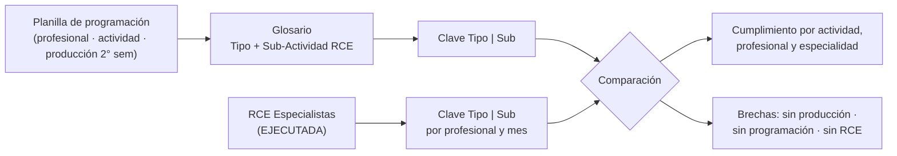

# Evaluación de la Programación Médica — Propuesta de diseño y estrategia

> Base de la propuesta: cruce real entre la planilla `Programacion.RRHH.230626.xlsx` (ya cargada en el panel), el [Glosario.xlsx](file:///c:/Users/Minsal/OneDrive/Aplicaciones%20Antigravity/Control%20de%20Gestion%20Web/src/data/Programaci%C3%B3n%20Hospital%20de%20Villarrica%202026/Glosario.xlsx) y la consulta RCE de Especialistas (`actividades_medicina_cached`, 228.518 atenciones, oct-2025 → 06-nov-2026).

## 1. Variables identificadas en el RCE de Especialistas

| Concepto del RCE | Variable en la consulta | Observación |
|---|---|---|
| **Tipo Actividad** | `tipo_consulta` | Ej.: `CONSULTA Y CONTROL`, `TELEMEDICINA CONTROL`, `ATENCION A HOSPITALIZADOS` |
| **Sub-Actividad** | `actividad` | Ej.: `CONSULTA NUEVA`, `CONTROL`, `CONSULTA ABREVIADA` |
| Profesional | `profesional_nombre` | Formato *Nombres Apellidos*, con `?` en vez de tildes/ñ |
| Especialidad / policlínico | `especialidad`, `policlinico` | Nomenclatura distinta a la planilla |
| Fecha | `fecha_atencion` | Permite corte mensual y por semestre |
| **¿Es producción?** | `estado_hora` | `EJECUTADA` = 207.970 (producción). `NO SE PRESENTO` 17.299, `NO SE ATENDIO` 1.698, `ASIGNADA` 1.550 (estas 3 últimas llegan sin Tipo/Sub) |

**Homologación:** actividad programada → *Glosario* (`TIPO DE ACTIVIDAD EN RCE` + `SUBACTIVIDAD RCE`) → clave `Tipo | Sub` → se cuenta en el RCE por profesional y período.



## 2. Hallazgos con los datos reales (condicionan el diseño)

> [!IMPORTANT]
> **La planilla tiene el 1° semestre vacío.** Producción comprometida 1° sem = 510 vs 2° sem = **165.876** (la planilla es la reprogramación de junio). La evaluación debe hacerse sobre el **2° semestre (jul–dic 2026)**.

| Hallazgo | Cifra |
|---|---|
| Producción comprometida 2° sem (actividades que requieren rendimiento) | 162.614 |
| …con equivalente en RCE de especialistas (**medible**) | **51.696 (32%)** |
| …**sin RCE de especialistas** (sala cama media/UTI/UCI, urgencia, imagenología, pabellón, etc.) | 110.918 (68%) |
| Meta devengada al 06-nov (90 de 127 días hábiles = 70,9%) en lo medible | 36.635 |
| Ejecutado en esas mismas claves | 22.731 → **62,0% de cumplimiento preliminar** |
| Distribución de 93 profesionales evaluables | 26 < 50% · 35 entre 50–79% · 15 entre 80–99% · 8 entre 100–119% · 9 ≥ 120% |
| Atenciones ejecutadas por profesionales programados **en claves que no tienen programadas** | 5.815 |
| Atenciones ejecutadas por profesionales **sin match en la programación** | 2.051 |
| Actividades de la planilla sin glosa en el Glosario | 406 de 1.514 |

**Problemas de calidad que hay que resolver antes de publicar números oficiales**
1. **Glosario ↔ RCE desalineados** en varias actividades (ej.: *Telemedicina: Teleconsulta Control* aparece como `TELEINTERCONSULTA SINCRONICA CONTROL` en el Glosario, pero en el RCE se registra como `TELEMEDICINA CONTROL | TELECONSULTA CONTROL`; *Interconsulta en sala* y *Atención especialista en sala* tampoco calzan con ninguna actividad programada).
2. **Nombres de profesionales:** 126 de 183 profesionales programados cruzan automáticamente; los que no, son en su mayoría anestesia/intensivo/becarios sin RCE ambulatorio, pero hay casos de escritura (`JOSE A INZUNZA` ↔ `INZUNZA NAVARRO JOSE ANTONIO`, `KATHARINA` ↔ `KATHERINA`). Se resuelve con una **tabla de alias** revisable.
3. **21 profesionales programados en 2 especialidades**: el RCE trae una sola `especialidad` por atención; se usará para repartir la producción entre ambas.
4. **El RCE no distingue presencial vs. telemedicina** salvo por el *Tipo Actividad*; por eso la meta se suma por clave `Tipo | Sub` (varias actividades programadas pueden compartir clave).

## 3. Taxonomía de estados (para que el lector vea siempre qué pasa con cada actividad)

| Estado | Significado | Color |
|---|---|---|
| **Evaluable con RCE** | Programada (con rendimiento) y con clave RCE. Se mide % cumplimiento | 🟢 ≥100% · 🟡 80–99% · 🟠 50–79% · 🔴 <50% |
| **Programada sin producción** | Tiene RCE, pero 0 atenciones ejecutadas en el período | ⚪ |
| **Sin RCE** | Se programa pero se registra fuera del RCE de especialistas (ej. hospitalizados, urgencia, imagenología, pabellón) → **no medible aquí** | 🟤 |
| **No requiere rendimiento (NR)** | Reuniones, gestión, comités | 🔵 |
| **Producción sin programación** | Atenciones ejecutadas en una clave que el profesional no tiene programada | 🟣 |
| **No homologada** | Actividad sin glosa / sin clave en el Glosario | ⚫ |

## 4. Reglas de cálculo propuestas

- **Período:** 2° semestre 2026 (jul–dic). Selector adicional para ver meses.
- **Meta devengada** = producción 2° sem × (días hábiles transcurridos ÷ días hábiles del semestre). Al corte de datos (06-nov): 90/127 = **70,9%**. Se podrá alternar a **meta del semestre completo**.
- **Cumplimiento** = atenciones `EJECUTADA` ÷ meta, por clave `Tipo | Sub`; el de **profesional** y **especialidad** es la suma de sus claves evaluables (no mezcla *Sin RCE* ni *NR*).
- **Resumen por lector:** para cada profesional se muestra siempre el balance *cumple / sin producción / sin RCE / fuera de programación*.
- Se mantiene la lógica de los filtros activos (proceso, RR, profesional, especialidad, **tipo de actividad programada**) sobre todos los cálculos.

## 5. Diseño visual propuesto

Nueva pestaña **“Evaluación”** dentro de *Programación Médica*, con 4 niveles de lectura (resumen → especialidad → profesional → actividad).

```
┌──────────────────────────────────────────────────────────────────────────────┐
│ EVALUACIÓN DE LA PROGRAMACIÓN · 2° Sem 2026 · RCE al 06-nov  [Meta: Devengada ▾]│
├──────────────────────────────────────────────────────────────────────────────┤
│ FILTROS: Especialidad ▾ · 🔎 Profesional · Tipo de actividad programada ▾(multi │
│ + buscador, agrupado por Tipo RCE) · Estado ▾ · Proceso ▾ · R/NR   [Exportar]   │
├──────────────────────────────────────────────────────────────────────────────┤
│ [Cumplimiento 62%] [Meta 36.635 | Real 22.731] [Sin producción: N act.]         │
│ [Producción sin programación 5.815] [Sin RCE: 68% de la meta] [No homologadas]  │
│ ▓▓▓▓▓▓▓▓░░░░ composición de la producción comprometida (medible/sin RCE/NR)    │
├──────────────────────────────────────────────────────────────────────────────┤
│ A) RANKING POR ESPECIALIDAD  (barra meta vs real, marca 100% y marca de avance  │
│    esperado 70,9%, semáforo, mini-barra de estados)                             │
│ B) DRILL-DOWN  Especialidad ▸ Profesional ▸ Tipo/Sub-Actividad                  │
│    Meta | Real | % (barra) | Δ | Estado (badge) | tendencia Jul–Nov (sparkline) │
└──────────────────────────────────────────────────────────────────────────────┘
 Ficha lateral del profesional (clic): 4 bloques de balance + gráfico mensual +
 tabla de actividades + listado “Producción fuera de programación”.
 Pestaña “Brechas”: programadas sin producción · producción sin programación ·
 actividades sin RCE · profesionales sin match.
```

- **Filtro “Tipo de actividad programada”**: selector múltiple con buscador, agrupado por *Tipo Actividad RCE* y con contador de actividades; reutiliza la ficha técnica actual (Tipo, Sub-Actividad, REM, definición) como tooltip fijable.
- **Exportación** a Excel del detalle por profesional/actividad con los estados.

## 6. Decisiones que necesito de ti

1. **Período y meta:** ¿evaluamos el **2° semestre con meta devengada** (recomendado) y permitimos ver la meta completa?
2. **Producción válida:** ¿solo atenciones **EJECUTADA**? (las *No se presentó* se mostrarían como información adicional).
3. **Homologación:** te entrego una **tabla Excel de homologación** (actividad programada → Tipo/Sub RCE, con estado *Sin RCE / Sin glosa / Desalineada*) para que la valides; es la base de todo el cálculo.
4. **Actualización del RCE:** los datos llegan al **06-nov**. ¿Puedo ejecutar `fetch-actividades-medicina.cjs` (requiere acceso al DSN `dwh.dssasur.cl`) antes de publicar?
5. **Alcance:** ¿partimos por **Programación Médica** y dejamos los **no médicos** para una segunda fase (requieren otra fuente: RUP APS)?
6. **Profesionales en 2 especialidades:** ¿se reparte por la especialidad que trae el RCE?
